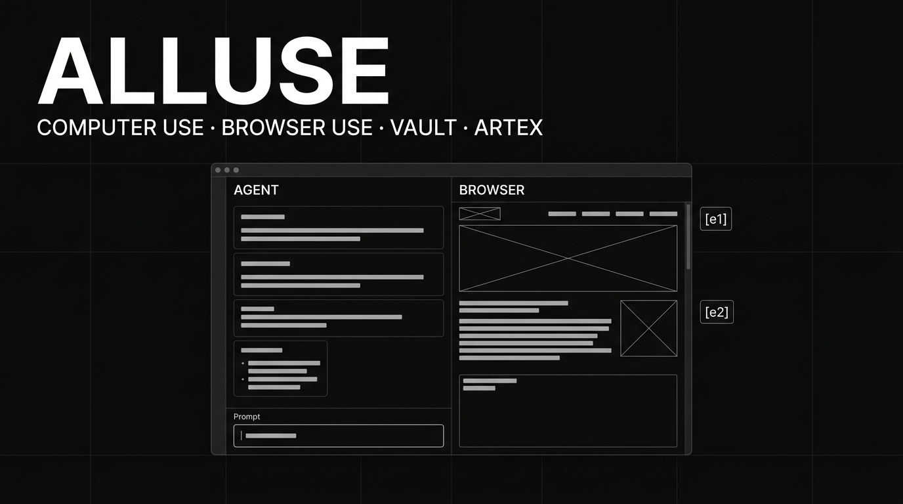
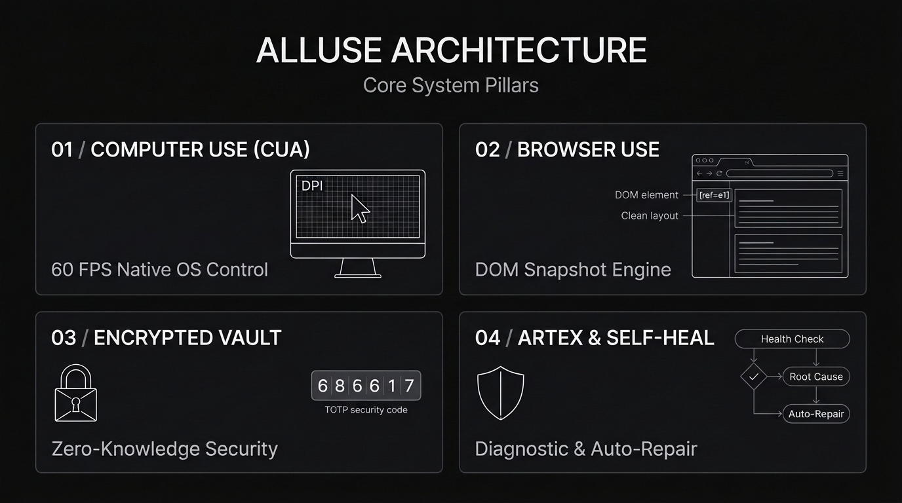

<div align="center">



<br />

# AllUse

**Lightweight single-binary native Rust workbench combining an autonomous AI control panel, AllCrew (`크루`) non-blocking parallel agents, live multi-tab OS browser, 60FPS desktop computer use, workspace coding tools, hardware-backed credential vault, 4K media studio, and scheduled workflows.**

[](./LICENSE)
[-111111?style=flat-square)](./Cargo.toml)
[](#quick-install)
[](#overview)

**[Overview](#overview) · [Quick Install](#quick-install) · [Core Capabilities](#core-capabilities) · [Security & Privacy](#security--local-first-privacy) · [CLI & Architecture](#cli-reference) · [한국어 가이드](#한국어-가이드)**

</div>

---

## Overview

**AllUse** is a cross-platform native desktop AI workbench written in Rust (`tao`, `wry`, `tokio`, and bundled SQLite WAL/FTS5) with zero Electron overhead. Its monochrome split-screen interface places your AI agent workspace on the left and a live OS-native multi-tab browser (`CoreWebView2` on Windows, `WKWebView` on macOS, `WebKitGTK 4.1` on Linux) on the right—so you and your agents operate on the exact same viewport, local files, and terminals in real time.

<div align="center">
  
</div>

---

## Quick Install

AllUse ships for **6 official native targets**: `win32-arm64`, `win32-x64`, `darwin-arm64`, `darwin-x64`, `linux-x64`, and `linux-arm64`.

### 1. Native GUI Installers (`AllUse-Setup`)

Download the prebuilt installer for your platform from [GitHub Releases](https://github.com/akitect45/cheapai-alluse/releases/latest):

| Platform | Architecture | Installer / Bundle |
| :--- | :--- | :--- |
| **Windows 11 ARM64** | Snapdragon / ARM64 | `AllUse-Setup-<version>-win32-arm64.exe` |
| **Windows 10 / 11 x64** | x86_64 / AMD64 | `AllUse-Setup-<version>-win32-x64.exe` |
| **macOS Apple Silicon** | M1–M4 (`darwin-arm64`) | `AllUse-Setup-<version>-darwin-arm64.dmg` |
| **macOS Intel** | x86_64 (`darwin-x64`) | `AllUse-Setup-<version>-darwin-x64.dmg` |
| **Linux x64** | Ubuntu / Fedora / Arch | `AllUse-Setup-<version>-linux-x64.run` |
| **Linux ARM64** | Server / Pi / Asahi | `AllUse-Setup-<version>-linux-arm64.run` |

### 2. One-Line CLI Installer or `npx`

- **Windows (PowerShell)**:
  ```powershell
  irm https://raw.githubusercontent.com/akitect45/cheapai-alluse/main/install.ps1 | iex
  ```
- **macOS & Linux (`bash` / `sh`)**:
  ```bash
  curl -fsSL https://raw.githubusercontent.com/akitect45/cheapai-alluse/main/install.sh | sh
  ```
- **Zero-Install via Node.js (`>= 18`)**:
  ```bash
  npx github:akitect45/cheapai-alluse
  ```

### 3. Build & Run from Source

Requires **Rust 1.85+** (2024 edition):

- **macOS & Linux**:
  ```bash
  git clone https://github.com/akitect45/cheapai-alluse.git
  cd cheapai-alluse
  ./alluse
  ```
- **Windows (PowerShell)**:
  ```powershell
  git clone https://github.com/akitect45/cheapai-alluse.git
  cd cheapai-alluse
  .\alluse.ps1
  ```
- **Manual Cargo Build**:
  ```bash
  cargo build --release --bin alluse --bin alluse-setup
  ```

<details>
<summary><strong>Platform Dependencies & OS Permissions</strong></summary>

- **Windows 10/11 (`x64` / `ARM64`)**: Uses pre-installed Evergreen Microsoft Edge WebView2 Runtime (`WebView2Loader.dll` is bundled automatically during build) and Windows DPAPI (`CryptProtectData`) for Vault encryption. On Snapdragon ARM64 devices, disabling Fast Startup (`HiberbootEnabled = 0`) is recommended to avoid DPAPI key desynchronization across cold boots.
- **macOS (`darwin-arm64` / `darwin-x64`)**: Uses system `WKWebView` with no extra packages required. To enable desktop mouse/keyboard automation and screen capture, grant **Accessibility** and **Screen Recording** permissions to your terminal or `AllUse` in **System Settings -> Privacy & Security**.
- **Linux (`x64` / `ARM64`)**:
  - **Ubuntu / Debian**: `sudo apt-get update && sudo apt-get install -y pkg-config build-essential libgtk-3-dev libwebkit2gtk-4.1-dev libjavascriptcoregtk-4.1-dev libsoup-3.0-dev libxdo-dev libssl-dev xdotool wmctrl xclip scrot grim slurp`
  - **Fedora / RHEL**: `sudo dnf install -y webkit2gtk4.1-devel gtk3-devel libxdo-devel openssl-devel pkgconf-pkg-config xdotool wmctrl xclip scrot grim slurp`
  - **Arch Linux**: `sudo pacman -S --needed webkit2gtk-4.1 gtk3 xdotool wmctrl xclip scrot grim slurp base-devel`
  - On headless Linux servers without X11/Wayland, launch with `alluse --headless` or `alluse --web`.

</details>

---

## Core Capabilities

1. **Embedded Multi-Tab Native Browser**
   - Isolated per-chat multi-tab browser workspaces hosted directly beside the chat pane, with automatic virtual DOM fallback in `--web` and `--headless` modes.
   - Structural `[ref=eN]` accessibility snapshots, incremental DOM diffs, CSS-schema extraction (`browser_extract`), Readability Markdown conversion (`browser_markdown`), semantic form detection, cookie/storage persistence, realistic DOM input events, and instant user takeover.
2. **60FPS Desktop Computer Use (CUA)**
   - Multi-monitor Per-Monitor DPI v2 screen capture (`screen_capture`), 1:1 lossless region inspection (`screen_zoom`), ease-out cubic mouse movement/clicking/dragging, Unicode/scancode keyboard entry, and window management.
   - Global hardware `ESC` interrupt + `Drop`-safe input guards immediately release held modifier keys or mouse buttons on cancellation.
3. **Project Workspace, Filesystem, Shell & GitHub Hub**
   - Bind any chat thread to a local repository or workspace folder, run regex file search (`fs_search`), clean file edits (`fs_edit_file`), and interruptible background shell commands (`shell_exec`).
   - Built-in Git commit graph, branch/PR overview, and CI log/watcher integration (`github_manage`).
4. **Hardware-Backed Vault & RFC 6238 TOTP**
   - Stores identities, payment cards, logins, 2FA secrets, and API tokens encrypted at rest via Windows DPAPI (`CryptProtectData`) or cross-platform `AU01` AEAD encryption.
   - **Zero-Leak Autofill**: Credentials are injected directly from Rust into the target browser fields without placing raw secrets into LLM conversation context.
5. **4K Image & Video Media Studio**
   - Integrated split-pane Image Studio and Video Studio supporting prompt generation, 2x/4K upscaling, reference frames, start/end frame transitions, audio generation toggles, and direct saving to your local `Pictures/AllUse` and `Videos/AllUse` directories.
6. **AllCrew (`크루`), Subagents, Persistent Memory & `.asl` Routines**
   - **AllCrew (`크루`) Non-Blocking Parallel Orchestration**: Dispatch parallel crew roles from a non-blocking `director` (`crew_manage`, `crew_post`, `crew_read`, `crew_wait`) backed by a SQLite-persisted `#seq` Crew Board, zero-polling wakeups, per-crew isolated browser sessions and Git worktrees, and autonomous `@verifier` -> `@director` handoffs while the main composer stays unlocked.
   - Hierarchical subagents with bidirectional mailboxes, SQLite FTS5 + 3-gram hybrid Markdown memory (`MEMORY.md`, `USER.md`, `SOUL.md`, `TAXONOMY.md`), scheduled cron routines, and deterministic AllScript (`.asl`) automation scripts.
7. **ARTEX Security Workbench & Self-Healing Runtime**
   - Optional scoped HTTP recon/repeater and finding retest workflow guarded by explicit scope allowlists, plus built-in health diagnostics (`--doctor`), verification (`--verify`), and self-repair (`--heal`).

---

## Security & Local-First Privacy

- **Local Storage Only**: Conversations, indexed memory, routines, and encrypted Vault records stay on your machine (`SQLite WAL/FTS5`).
- **Two-Stage SSRF Defense**: Browser extraction and network tools validate target URLs both before lookup and after DNS resolution to block loopback, RFC 1918 private networks, link-local / cloud metadata IMDS endpoints (`169.254.169.254`), and IPv6 transition tunnels (`::ffff:`, NAT64, 6to4, Teredo).
- **Hardened Loopback Server**: Local HTTP/SSE server binds strictly to `127.0.0.1` (`8877` by default), validates `Host`/`Origin`/`Sec-Fetch-Site`, enforces frame-ancestors `'none'`, and restricts arbitrary path traversal.
- **Credential Hygiene**: Vault secrets and masked API keys remain redacted across logs, snapshots, and LLM tool outputs.

---

## CLI Reference

| Command | Description |
| :--- | :--- |
| `alluse` | Launch the native split-screen desktop workbench (`127.0.0.1:8877`). |
| `alluse --web` / `--server` | Run the local workbench server and open it in your default browser. |
| `alluse --headless` | Run without opening a GUI window (ideal for headless Linux hosts or automation). |
| `alluse --doctor` | Check OS target, WebView runtime, CUA permissions, SQLite WAL, and Vault status. |
| `alluse --verify` | Run built-in verification checks (Vault encryption, TOTP, SSRF guard, DOM tools). |
| `alluse --heal` | Run self-diagnostics and runtime repair routines. |
| `alluse --run-asl <target>` | Execute an AllScript (`.asl`) workflow by preset ID, name, or file path. |
| `alluse --version` | Show application version and host target triple. |

---

## Project Structure

```text
├── src/
│   ├── main.rs            # Native desktop host (tao + wry multi-tab OS WebView) & CLI entrypoint
│   ├── agent.rs           # Agent turn loop, subagent mailboxes & unified tool dispatcher
│   ├── crew.rs            # AllCrew (크루) non-blocking director, SQLite CrewBoard & worktree isolation
│   ├── llm.rs             # Streaming LLM API client & response parser
│   ├── browser.rs         # Multi-tab WebView/Virtual DOM engine, SSRF guard & extraction tools
│   ├── browser_agent.js   # Document-start page runtime (snapshots, forms, autofill, AI cursor)
│   ├── cua.rs             # Cross-platform 60FPS desktop capture, mouse/keyboard input & ESC kill-switch
│   ├── vault.rs           # DPAPI / AU01 AEAD encrypted vault & RFC 6238 TOTP generator
│   ├── db.rs              # SQLite WAL/FTS5 store, thread workspaces, memory & routines
│   ├── media.rs           # Local Image & Video Studio pipeline & thumbnail/asset storage
│   ├── allscript.rs       # Deterministic `.asl` automation parser & interpreter
│   ├── artex.rs           # Scoped security recon, HTTP repeater & verification guards
│   ├── github.rs          # Local Git inspection, commit DAG & GitHub PR/CI integration
│   ├── server.rs          # Hardened loopback HTTP + SSE control server
│   ├── self_heal.rs       # Diagnostics, snapshots, runtime repair & hot-rebuild validation
│   ├── config.rs          # Config loader, provider sync & cross-platform path defaults
│   ├── search.rs          # Offline/local headless search helper
│   ├── web_guidance.rs    # Embedded Baseline Web UI best-practice scanner & lookup
│   ├── dpi_win32.rs       # Per-Monitor DPI v2 coordinate calibration (Windows)
│   ├── win32_ffi.rs       # Native Win32 input, DPAPI & window bindings (Windows)
│   ├── ui.html            # Standalone monochrome desktop workbench frontend
│   ├── installer_ui.html  # Graphical cross-platform installer frontend
│   └── bin/alluse_setup.rs # Self-extracting native installer binary
├── bin/                   # Node CLI wrapper (`npx`)
├── scripts/               # Icon generator, custom installer packager & release manifest tools
└── .github/workflows/     # 6-target CI release automation (Windows, macOS, Linux)
```

---

<a id="한국어-가이드"></a>

## 한국어 가이드

**AllUse**는 Electron 없이 순수 Rust(`tao` + `wry` + `tokio` + `SQLite WAL/FTS5`)로 구현된 크로스플랫폼 네이티브 AI 데스크톱 워크벤치입니다. 좌측 에이전트 워크벤치와 우측 **OS 네이티브 멀티탭 브라우저(`CoreWebView2` · `WKWebView` · `WebKitGTK 4.1`)**가 한 화면에서 결합되어, 브라우저 탐색·데스크톱 제어(CUA)·프로젝트 코드 작업·이미지/비디오 스튜디오·로컬 보안 금고를 단일 앱에서 실행합니다.

### 빠른 설치

- **Windows 10/11 (`x64` · `ARM64`) — PowerShell**:
  ```powershell
  irm https://raw.githubusercontent.com/akitect45/cheapai-alluse/main/install.ps1 | iex
  ```
- **macOS (`Apple Silicon` · `Intel`) 및 Linux (`x64` · `ARM64`)**:
  ```bash
  curl -fsSL https://raw.githubusercontent.com/akitect45/cheapai-alluse/main/install.sh | sh
  ```
- **소스 코드에서 바로 실행**:
  ```bash
  git clone https://github.com/akitect45/cheapai-alluse.git && cd cheapai-alluse
  ./alluse        # macOS / Linux
  .\alluse.ps1    # Windows PowerShell
  ```

### 주요 기능 요약

1. **내장 멀티탭 브라우저 자동화**: 대화 스레드별 완전 독립 탭 공간, `[ref=eN]` 구조화 스냅샷, CSS 스키마 추출, Markdown 변환, 2단계 SSRF/사설망 차단, 사용자 제어권 인계 지원.
2. **60FPS 데스크톱 컴퓨터 제어(CUA)**: Per-Monitor DPI v2 화면 캡처, 1:1 정밀 줌, 부드러운 마우스/키보드 입력, `ESC` 하드웨어 긴급 중단.
3. **하드웨어 기반 로컬 보안 금고(Vault)**: Windows DPAPI / 크로스플랫폼 AEAD 로컬 암호화, LLM 프롬프트에 평문을 남기지 않는 브라우저 직접 자동 입력, 2FA(TOTP) 지원.
4. **이미지 & 비디오 스튜디오**: 분할 패널에서 4K 이미지 생성, 2x 업스케일, 시작/끝 프레임 비디오 생성 및 로컬 PC(`Pictures/AllUse`, `Videos/AllUse`) 즉시 저장.
5. **프로젝트 작업 공간 · GitHub 허브 · 영구 메모리 · 루틴**: 대화별 작업 폴더 연결, 파일 검색/편집/백그라운드 셸, 커밋 그래프·PR 워처, SQLite FTS5 기반 기억 관리 및 `.asl` 스케줄 실행.
6. **AllCrew (`크루`) 비차단 병렬 멀티에이전트**: 메인 입력창을 잠그지 않는 `디렉터` 즉시 분할 배정, SQLite 영속 `#seq` 크루 보드, 무폴링 `crew_wait`, 크루별 독립 브라우저 세션·Git 워크트리 격리 및 검수 크루 자동 콜백 지원.

### 운영체제별 권한 참고

- **macOS**: 데스크톱 제어(CUA) 사용 시 **시스템 설정 → 개인정보 보호 및 보안**에서 `손쉬운 사용(Accessibility)` 및 `화면 및 시스템 오디오 녹음` 권한을 허용하세요.
- **Windows ARM64 (Snapdragon)**: 재부팅 후 DPAPI 키 불일치를 예방하려면 빠른 시작(`HiberbootEnabled = 0`) 해제를 권장합니다.
- **헤드리스 Linux 서버**: X11/Wayland 없이 `alluse --headless` 또는 `alluse --web` 모드로 바로 실행할 수 있습니다.

---

## License

Released under the [MIT License](./LICENSE).
